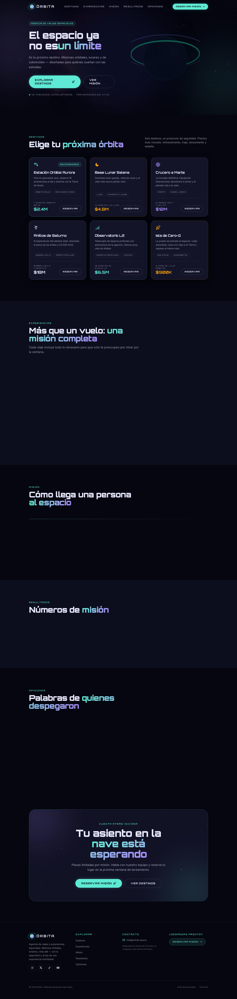

# 🌌 Órbita — Landing Page

> **El espacio ya no es un límite, es tu próximo destino.** — Landing page de marca para *Órbita*, agencia de viajes y experiencias espaciales.

Landing page estática construida con **Astro 7 + Tailwind CSS v4 + TypeScript + Three.js**, preparada para **Cloudflare Pages**. Serie de 9 landing pages por estilo de diseño (este proyecto: **Futurismo 3D**).




---

## 🚀 Demo en producción

| Recurso | URL |
|---|---|
| Producción (Cloudflare Pages) | `https://orbita.stevemoya.me` *(cuando conectes el repo)* |
| Preview Pages | `https://landing-orbita.pages.dev` |

---

## 🧱 Stack

- **Astro 7** — SSG puro (`output: static`), sin adaptador (Cloudflare Pages sirve `dist/`)
- **Tailwind CSS v4** — tokens de marca en `src/styles/global.css` (`@theme`)
- **TypeScript 5** estricto
- **Three.js 0.185** — planeta 3D procedural del hero (carga diferida `dynamic import`, pausa fuera de viewport, fallback CSS)
- **@astrojs/sitemap** + Fontsource (Orbitron, Inter Variable) auto-hospedadas

## 📁 Arquitectura

```
src/
├── components/
│   ├── ui/          → Button, Card (glass), Badge (HUD), Icon, Section, Container
│   ├── layout/      → Header, Navigation, MobileMenu (vanilla JS), Footer
│   ├── sections/    → Hero (planeta 3D), Destinations, Experiences, Mission, Stats, Testimonials, CTA
│   └── brand/       → Logo (planeta con anillo)
├── data/            → contenido tipado: site, destinations, experiences, mission, stats, testimonials
├── layouts/BaseLayout.astro  → SEO + OG + JSON-LD
├── pages/           → index.astro, 404.astro
├── scripts/         → header (vanilla), reveal (IO), stats (contadores), hero-planet (Three.js)
└── styles/global.css → Design System: tokens espacio profundo + reveal + reduced-motion
public/              → _headers (CSP), favicon.svg, robots.txt, og.png
```

## 🎨 Design System (Futurismo espacial)

| Token | Valor | Uso |
|---|---|---|
| `void` | `#05060F` | fondo |
| `nebula` | `#1A1B33` | superficies |
| `ion` | `#5EEAD4` | cian neón primario |
| `pulse` | `#A78BFA` | violeta secundario |
| `stardust` | `#E8EAFF` | texto claro |
| `orbit` | `#F59E0B` | acento CTA |

- **Tipografía:** Orbitron (display futurista, 500/700/900) + Inter Variable (body) + labels HUD monoespaciadas
- **Lenguaje visual:** glass sutil en cards, bordes `1px` con alpha, gradientes nebulosa, sombras neón, estrellas twinkle
- **Hero 3D:** esfera procedural + wireframe técnico + 2 anillos (torus) + 900 estrellas; rota siguiendo el cursor; pausa fuera de viewport; fallback CSS con reduced-motion o sin WebGL
- **Interactividad:** vanilla JS (menú móvil, header scrolled, contadores) — sin frameworks, CSP estricta sin `unsafe-eval`

## 🛠️ Scripts

```bash
pnpm install
pnpm dev            # desarrollo → http://localhost:4321
pnpm build          # build → dist/
pnpm preview        # preview local
pnpm check          # astro check (tipos)
```

## 🔐 Variables de entorno

Ninguna requerida. Sitio 100 % estático.

## ☁️ Deploy en Cloudflare Pages

1. [dash.cloudflare.com](https://dash.cloudflare.com) → **Workers & Pages → Create → Pages → Connect to Git** → repo `landing-orbita`.
2. Build: **Build command** `pnpm build` · **Output directory** `dist` · Node 22+.
3. Deploy → Custom domains → `orbita.stevemoya.me`.

> ⚠️ Crearlo como **Pages**, no como Worker (el flujo Worker ejecuta `astro add cloudflare` y falla).

## 🛡️ Seguridad

- `_headers`: CSP estricta (`default-src 'self'`, **sin** `unsafe-eval` — vanilla JS), HSTS, nosniff, frame DENY
- Sin secretos; `.env`/`.dev.vars` ignorados
- `security.checkOrigin: true`

## 📝 Decisiones de implementación

- **Three.js solo en el hero** y con `dynamic import` → el bundle 3D (~150 KB) no bloquea el render
- **Fallback en capas**: sin WebGL o `prefers-reduced-motion` → planeta CSS estático (sin JS)
- **Cursor interactivo** solo desktop; en móvil rotación automática lenta
- **Sin Alpine en este proyecto** (a diferencia de Nori): interactividad vanilla → CSP estricta sin eval
- **Datos mock** (destinos, experiencias, misión, stats, testimonios) — marca ficticia
- CTA vía `mailto:` con asunto pre-llenado

## 🧪 QA

```bash
pnpm check
pnpm build
```

Verificado: build limpio, contraste AA, sin overflow (desktop/móvil), WebGL activo (planeta renderizando), menú móvil y contadores funcionales.

---

© 2026 Órbita — Proyecto de portafolio de Steve Moya.
